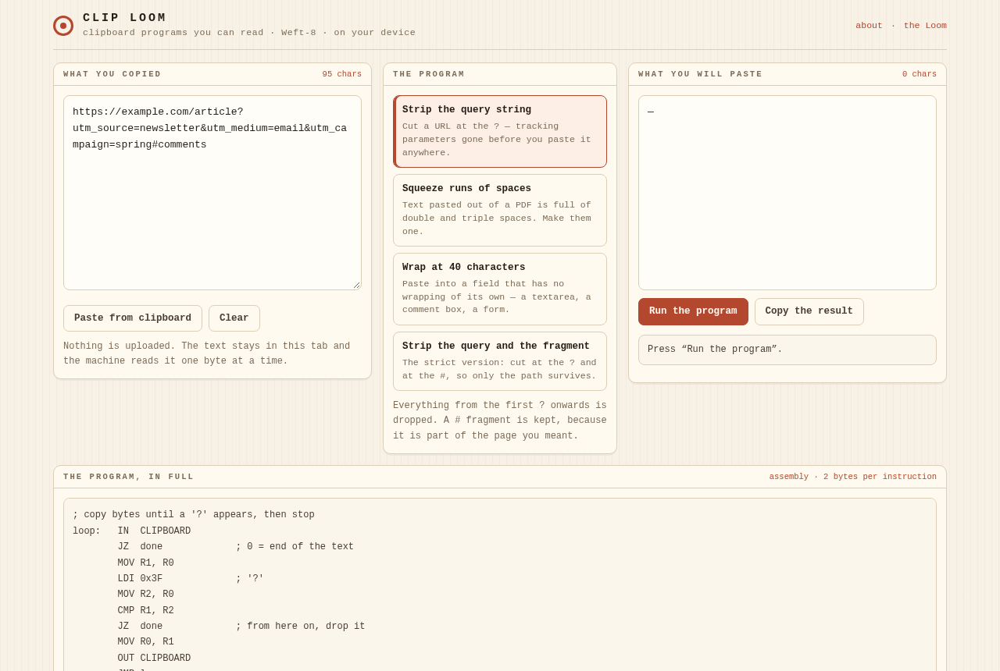

<div align="center">

# Clip Loom

<!-- shot:start -->



<!-- shot:end -->

**Clean it before you paste it — with programs you can read.**

[](https://drsamonline.github.io/app-clip-loom/)
[](https://github.com/drsamonline/app-clip-loom/actions/workflows/test.yml)
[](https://github.com/drsamonline/app-clip-loom/actions/workflows/build-apps.yml)
[](https://github.com/drsamonline/app-clip-loom/releases/latest)
[](LICENSE)
[-b4482f?style=flat-square&labelColor=231d16)](https://github.com/drsamonline/app-jacquard)

[**Open the tool →**](https://drsamonline.github.io/app-clip-loom/)

</div>


A link with eleven tracking parameters. Text pulled out of a PDF with three spaces between every word. A
paragraph going into a field that will not wrap. Clip Loom does those jobs with **programs you can read
in full** — twenty lines of Weft-8 assembly each, running on a machine that lives in the page.

## The five programs

| Program | What it does | The idea it uses |
|---|---|---|
| **Strip the query string** | cut a URL at the `?` | compare each byte with `0x3F`, stop when it matches |
| **Squeeze runs of spaces** | `a    b` → `a b` | remember the *previous* byte in a register and compare |
| **Wrap at 40 characters** | insert a newline every 40 | count down in a register and refill it — the same code for any length |
| **Strip query and fragment** | cut at `?` and at `#` | two terminators instead of one |
| **One line per sentence** | newline after every `.` | one more comparison in the copy loop |

Every program reads one byte at a time from the `CLIPBOARD` port, decides, and writes. No regular
expressions, no library, nothing you cannot follow with a pencil.

## Built on the Loom

This app does not carry its own computer. `docs/play/weft8.js` is the **Weft-8** from
[Jacquard (the Loom)](https://github.com/drsamonline/app-jacquard) — byte for byte the same engine, the
same one its 102 assertions cover. What this repository adds is a host: a clipboard that hands the
machine one byte at a time and collects what it writes.

That is the whole design. The machine is shared; the job is a peripheral.

## Run it

Open `docs/index.html`, or use the [live demo](https://drsamonline.github.io/app-clip-loom/). The Windows
EXE and Android APK are on the [rolling release](https://github.com/drsamonline/app-clip-loom/releases/latest).

Your text never leaves the tab: the machine reads it in the page, and the clipboard buttons use the
browser's own clipboard API with a plain "select and copy" fallback if the browser refuses.

## Test it

```
npm install
node test-node.js          # 66 assertions — the machine and every program
node tests/page-smoke.js   # 9 assertions — the page, driven in jsdom
```

The program suite runs **every example each program ships** on the real machine, then the edges: the
empty clipboard, text with no `?`, a run of five spaces, and a 120-character paragraph that must wrap
into four lines with no character lost. It also checks the programs **bite**: delete the `?` comparison
from program 01 and the example that says the query must go starts failing.


## The Weft-8 family

One machine, seven faces. Every one of these runs `weft8.js` from the Loom, byte for byte —
learn it once and you have learned all seven.

| | what it is |
|---|---|
| [the Loom](https://drsamonline.github.io/app-jacquard/) | the machine and its editor — where it all starts |
| [Weft Puzzles](https://drsamonline.github.io/app-weft-puzzles/) | five puzzles solved in assembly, a robot on a grid |
| **Clip Loom** (you are here) | clipboard programs you can read: strip, squeeze, wrap |
| [Weft-8 on hardware](https://drsamonline.github.io/weft8-hardware/) | the same machine in C, three-way parity with the JS one |
| [weft8-kit](https://drsamonline.github.io/weft8-kit/) | rules small enough to sign off |
| [Weft-8 Classroom](https://drsamonline.github.io/weft8-classroom/) | eight exercises that teach how a computer works |
| [Weft-8 beside x86 and ARM](https://drsamonline.github.io/weft8-compare/) | the same four jobs in three machines |

## Support


Free, offline, accountless — and staying that way. If it earned its keep:

| | |
|---|---|
| UPI (India) | `drsohilboi@ybl` — payee Dr. Sohil Momin, open amount, or scan [the QR](docs/assets/upi-qr.svg) |
| GitHub Sponsors | [github.com/sponsors/drsamonline](https://github.com/sponsors/drsamonline) |
| Ko-fi | [ko-fi.com/matneo](https://ko-fi.com/matneo) |
| PayPal | [paypal.me/drsohilmomin](https://paypal.me/drsohilmomin?locale.x=en_GB&country.x=IN) |
| My books | [Amazon author store](https://www.amazon.com/stores/author/B08ZT331LY/allbooks?ccs_id=aed72b9f-71d9-41dc-adee-e9368a317acc) |
| More apps | [drsamonline.github.io](https://drsamonline.github.io/) |
| Email | [sohilmomin2000@gmail.com](mailto:sohilmomin2000@gmail.com) |

Nothing is gated behind it: no accounts, no tracking, no network requests.

## Licence

**PolyForm Noncommercial 1.0.0** · © 2026 Dr Sohil Momin. Free for any noncommercial purpose.
